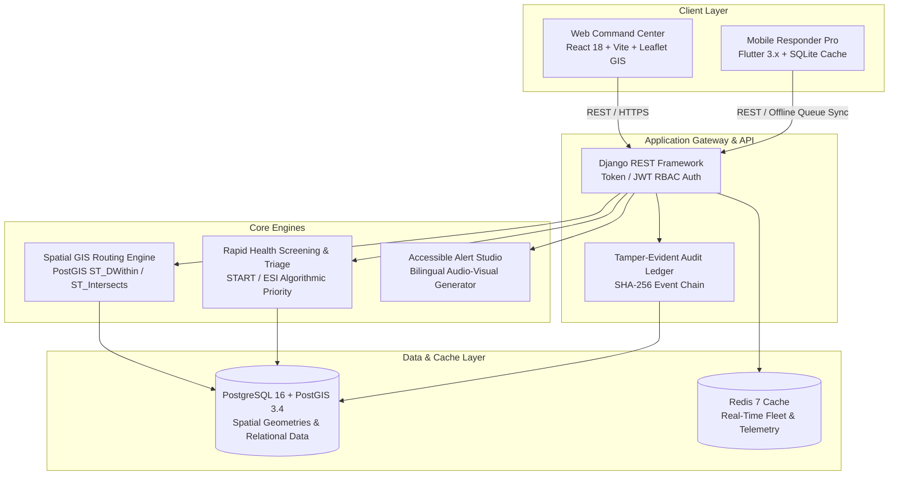
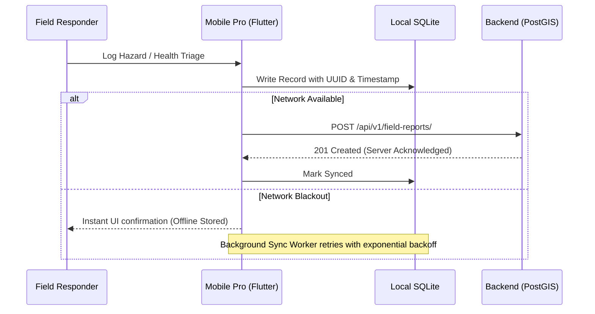
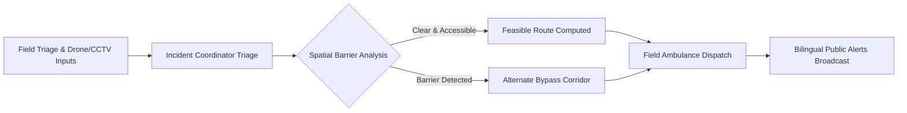

# EvacAccess India — Technical Design Document (TDD)

## 1. System Architecture Overview

EvacAccess India is an emergency decision-support and tactical GIS orchestration system built for mass gatherings such as the Kumbh Mela. It consists of three primary tiers:

---

## 2. Core Functional Components

### 2.1 3-State Truth Deterministic Routing Engine
Unlike conventional navigation systems that assign blanket "safe" ratings to unmonitored roads, EvacAccess enforces an evidence-backed 3-State classification:
- **`FEASIBLE_WITH_AVAILABLE_DATA`**: Traversed polygon/segment has been inspected within the freshness window and verified clear of physical bottlenecks or high crowd density.
- **`UNSUITABLE`**: Segment intersects verified hazards (stampede choke points, submerged pontoon bridges, steep staircases impassable by stretchers/wheelchairs).
- **`UNVERIFIED`**: Stale data (> 60 minutes) or uninspected corridors. Requires field reconnaissance before mass dispatch.

### 2.2 Offline-First Edge Synchronization (Mobile Responder Pro)
During mass gatherings, cellular connectivity degrades drastically. The mobile application operates with an SQLite persistence buffer:

### 2.3 Health Screening & Syndromic Surveillance
- **Triage Matrix**: Color-coded categorization (`RED: Immediate`, `YELLOW: Urgent`, `GREEN: Minimal`, `BLACK: Expectant`).
- **Syndromic Outbreak Cluster Detection**: Flags sudden surges in Acute Gastroenteritis (AGE) or Acute Respiratory Infection (ARI) across Mela sectors to alert the Chief Medical Officer.

---

## 3. Data Flow Diagram

---

## 4. Security, Privacy & Audit Trail
- **Role-Based Access Control (RBAC)**: Enforced across 5 roles: `Administrator`, `Incident Coordinator`, `Supervisor`, `Field Responder`, and `Demo Viewer`.
- **Anonymized Patient References**: Triage entries use generated tokens (e.g., `EA-KM-1042`) without exposing personal Aadhaar/phone records on open map layers.
- **Cryptographic Audit Ledger**: Every assignment, shelter status change, and hazard override is written to an append-only audit table with actor ID, timestamp, and SHA-256 payload digest.
